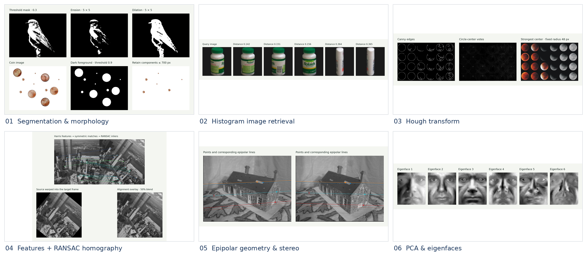

# Computer Vision in Python

**Six classical computer-vision studies in Python and NumPy, with reproducible figures, numerical tests and an interactive showcase.**
Machine Perception (*Umetno zaznavanje*), University of Ljubljana · course grade 9/10

[](https://gabercmatej.github.io/Machine-perception-course/)

[Run it yourself](#quick-start) · [Provenance](PROVENANCE.md)




## What is inside

| # | Study | Implemented here | Key idea |
|---|---|---|---|
| 1 | [Image processing, histograms & morphology](#assignment-1) | thresholding, normalised histograms, Otsu, erosion/dilation, connected components | images are arrays; shape is a set operation |
| 2 | [Convolution, filtering & image retrieval](#assignment-2) | 1D/2D convolution, Gaussian and median filters, 3D colour histograms, four distance measures | local operators and global descriptors |
| 3 | [Derivatives, edges & the Hough transform](#assignment-3) | Gaussian derivatives, gradient magnitude and angle, non-maximum suppression, line and circle Hough voting | evidence accumulates in parameter space |
| 4 | [Feature detection, matching & homography](#assignment-4) | Hessian and Harris detectors, mutual nearest-neighbour matching, DLT homography, RANSAC | robust estimation despite outliers |
| 5 | [Disparity, epipolar geometry & triangulation](#assignment-5) | NCC stereo matching, eight-point fundamental matrix with rank-2 constraint, linear triangulation | two views constrain a point to a line |
| 6 | [PCA, dimensionality reduction & eigenfaces](#assignment-6) | direct and dual PCA, reconstruction from k components, eigenfaces | most image variance lives in few directions |

The core methods (Gaussian kernels, edge thinning, Hough voting, Harris and Hessian responses, DLT and RANSAC, the eight-point algorithm, triangulation and PCA) are written with NumPy; OpenCV provides filtering, morphology and image I/O utilities. Each assignment folder keeps the original submission and brief; [`showcase/`](showcase/README.md) holds reusable modules, figure generators and numerical tests that regenerate every result in this README from one command.

## Interactive showcase

<a href="https://gabercmatej.github.io/Machine-perception-course/"></a>

A static web app built on the generated results: choose any of the six studies, adjust parameters such as thresholds, kernel sizes or the number of PCA components, and compare outputs side by side. **[Open it →](https://gabercmatej.github.io/Machine-perception-course/)**

## Quick start

```sh
cd showcase && python -m venv .venv && source .venv/bin/activate
pip install -r requirements.txt
python -m cvportfolio.generate                # regenerate every figure from the course data
python -m unittest discover -s tests -v       # numerical checks of the core algorithms
```

## Assignment 1

### Image processing, histograms & morphology

**Quick summary.** Images become arrays: manipulate pixels, measure intensity distributions, and separate foreground regions.

- **Basic image processing:** Load RGB images, compute grayscale from channel means, inspect a green-channel crop, invert a rectangular patch and reduce the intensity range. Array slicing and broadcasting let the same operation act on thousands of pixels.
- **Thresholding & histograms:** Implement threshold masks in two ways and build a normalized histogram with configurable bins. Compare exposure distributions, then select a foreground threshold with Otsu’s between-class criterion.
- **Morphology & connected components:** Implement erosion and dilation experiments, clean a bird mask, apply it to RGB channels, invert an eagle mask and filter coin-image connected components by area. Morphology changes local shape; component analysis selects whole regions.

[Original Python](assignment1/assigment1.py) · [Assignment PDF](assignment1/instructions.pdf) · [Detailed walkthrough](assignment1/README.md)

<table>
<tr><td width="50%" valign="top"><br><sub><b>1.1 Basic image processing</b></sub></td><td width="50%" valign="top"><br><sub><b>1.2 Thresholding & histograms</b></sub></td></tr>
<tr><td width="50%" valign="top"><br><sub><b>1.3 Morphology & connected components</b></sub></td><td width="50%" valign="top"><br><sub><b>Bird segmentation & foreground masking</b></sub></td></tr>
</table>

▶ **[Open Assignment 1 in the interactive showcase](https://gabercmatej.github.io/Machine-perception-course/#study-1)**: Compare the full segmentation pipeline with its extracted foreground. The task gallery also lets you browse every result shown above.

---

## Assignment 2

### Convolution, filtering & image retrieval

**Quick summary.** Build local signal operators, compare noise-removal filters, and search an image collection with compact color descriptions.

- **1D convolution:** Write convolution and boundary handling, generate normalized Gaussian kernels for several scales, and explore how composing kernels changes a signal. A kernel slides over neighboring samples and forms a weighted sum.
- **Image filtering:** Apply separable Gaussian filtering to noisy images, sharpen with a custom kernel, compare 1D median windows and implement a 2D median filter. Median filtering rejects isolated impulses while Gaussian averaging smooths both noise and detail.
- **Global descriptors & retrieval:** Build an 8 × 8 × 8 RGB histogram, implement L2, chi-square, intersection and Hellinger distances, rank a 120-image collection, inspect sorted distances and weight frequent colors less strongly.

[Original Python](assignment2/assigment2.py) · [Assignment PDF](assignment2/assignment2_instructions.pdf) · [Detailed walkthrough](assignment2/README.md)

<table>
<tr><td width="50%" valign="top"><br><sub><b>2.1 1D convolution</b></sub></td><td width="50%" valign="top"><br><sub><b>2.2 Image filtering</b></sub></td></tr>
<tr><td width="50%" valign="top"><br><sub><b>2.3 Global descriptors & retrieval</b></sub></td><td width="50%" valign="top"><br><sub><b>Sharpening comparison</b></sub></td></tr>
<tr><td width="50%" valign="top"><br><sub><b>Four distance functions & frequency weighting</b></sub></td><td width="50%"></td></tr>
</table>

▶ **[Open Assignment 2 in the interactive showcase](https://gabercmatej.github.io/Machine-perception-course/#study-2)**: Switch between noise removal and image retrieval. The task gallery also lets you browse every result shown above.

---

## Assignment 3

### Derivatives, edges & the Hough transform

**Quick summary.** Progress from local intensity changes to thin edges and geometric line or circle hypotheses.

- **Image derivatives:** Construct Gaussian derivative filters, inspect impulse responses, calculate first and second image derivatives, and derive gradient magnitude and orientation. Also implement an 8 × 8 spatial grid with 8 orientation bins: a 512-dimensional gradient descriptor.
- **Edge detection:** Threshold gradient magnitude, suppress responses across the gradient direction, then use connected-component hysteresis to retain weak edges linked to strong ones. Each step removes a different kind of ambiguity.
- **Hough voting:** Implement line-parameter accumulators, threshold peaks, suppress neighboring maxima and draw strong line hypotheses on images. Extend voting to circle centers when the radius is known.

[Original Python](assignment3/assigment3.py) · [Assignment PDF](assignment3/assignment3_instructions.pdf) · [Detailed walkthrough](assignment3/README.md)

<table>
<tr><td width="50%" valign="top"><br><sub><b>3.1 Image derivatives</b></sub></td><td width="50%" valign="top"><br><sub><b>3.2 Edge detection</b></sub></td></tr>
<tr><td width="50%" valign="top"><br><sub><b>3.3 Hough voting</b></sub></td><td width="50%" valign="top"><br><sub><b>Known-radius circle detection</b></sub></td></tr>
</table>

▶ **[Open Assignment 3 in the interactive showcase](https://gabercmatej.github.io/Machine-perception-course/#study-3)**: Move the edge threshold slider across four computed settings. The task gallery also lets you browse every result shown above.

---

## Assignment 4

### Feature detection, matching & homography

**Quick summary.** Find distinctive points, match local descriptions across views, and estimate an image alignment despite outliers.

- **Hessian & Harris detectors:** Calculate second-derivative and structure-tensor responses, select strong locations and compare detector behavior at different scales. Hessian responses emphasize blob-like structure; Harris responses emphasize variation in two directions.
- **Local descriptor matching:** Compare supplied local descriptors using Hellinger distance, first with one-way nearest neighbors and then with a mutual-match check. This removes pairs that do not agree in both directions. The source also contains video stabilization experiments.
- **Homography & RANSAC:** Estimate a projective transform with DLT, align supplied point pairs, explore line-fitting RANSAC, reject feature-match outliers, measure reprojection error and implement inverse nearest-neighbor warping.

[Original Python](assignment4/assigment4.py) · [Assignment PDF](assignment4/assignment4_instructions.pdf) · [Detailed walkthrough](assignment4/README.md)

<table>
<tr><td width="50%" valign="top"><br><sub><b>4.1 Hessian & Harris detectors</b></sub></td><td width="50%" valign="top"><br><sub><b>4.2 Local descriptor matching</b></sub></td></tr>
<tr><td width="50%" valign="top"><br><sub><b>4.3 Homography & RANSAC</b></sub></td><td width="50%"></td></tr>
</table>

▶ **[Open Assignment 4 in the interactive showcase](https://gabercmatej.github.io/Machine-perception-course/#study-4)**: Drag the alignment comparison slider and inspect matched points. The task gallery also lets you browse every result shown above.

---

## Assignment 5

### Disparity, epipolar geometry & triangulation

**Quick summary.** Use the relationship between two views to estimate pixel displacement and recover sparse 3D structure.

- **Disparity from stereo images:** Explore the inverse relationship between depth and disparity, implement normalized cross-correlation patch matching, and experiment with consistency filtering, median smoothing and disparity-based warping.
- **Fundamental matrix:** Build the normalized eight-point system, solve it with SVD, enforce rank two, draw epipolar lines and calculate symmetric point-to-line distances. A point in one image restricts its match to a line in the other.
- **Linear triangulation:** Stack camera projection constraints and solve for each homogeneous 3D point with SVD. Visualize the recovered house and experiment with fundamental-matrix RANSAC before triangulation.

[Original Python](assignment5/assigment5.py) · [Assignment PDF](assignment5/assignment5_instructions.pdf) · [Detailed walkthrough](assignment5/README.md)

<table>
<tr><td width="50%" valign="top"><br><sub><b>5.1 Disparity from stereo images</b></sub></td><td width="50%" valign="top"><br><sub><b>5.2 Fundamental matrix</b></sub></td></tr>
<tr><td width="50%" valign="top"><br><sub><b>5.3 Linear triangulation</b></sub></td><td width="50%"></td></tr>
</table>

▶ **[Open Assignment 5 in the interactive showcase](https://gabercmatej.github.io/Machine-perception-course/#study-5)**: Rotate the reconstructed 3D house and inspect the two input views. The task gallery also lets you browse every result shown above.

---

## Assignment 6

### PCA, dimensionality reduction & eigenfaces

**Quick summary.** Learn directions of variation, compress observations, and reconstruct faces from a small set of coefficients.

- **Direct PCA:** Compute the mean, covariance and eigenvectors; draw principal directions; project points onto one component; compare nearest neighbors before and after projection; select components retaining 80% of variance in 50D data.
- **Dual PCA:** Decompose the sample-space covariance matrix, map its eigenvectors back to feature space, compare nonzero eigenvalues with direct PCA and reconstruct the original points. This is useful when there are many more pixels than training images.
- **Face-space decomposition:** Load faces as columns, compute eigenfaces, reconstruct images, compare pixel edits with coefficient edits, sweep component counts, vary the first two coefficients and project an elephant image into face space. A webcam-recognition example is also preserved.

[Original Python](assignment6/exercise6.py) · [Assignment PDF](assignment6/assignment6_instructions.pdf) · [Detailed walkthrough](assignment6/README.md)

<table>
<tr><td width="50%" valign="top"><br><sub><b>6.1 Direct PCA</b></sub></td><td width="50%" valign="top"><br><sub><b>6.2 Dual PCA</b></sub></td></tr>
<tr><td width="50%" valign="top"><br><sub><b>6.3 Face-space decomposition</b></sub></td><td width="50%" valign="top"><br><sub><b>Learned eigenfaces</b></sub></td></tr>
</table>

▶ **[Open Assignment 6 in the interactive showcase](https://gabercmatej.github.io/Machine-perception-course/#study-6)**: Change the number of PCA components and compare face reconstructions. The task gallery also lets you browse every result shown above.

---

## Run the code

Original scripts, PDFs and supplied data live in `assignment1/` through `assignment6/`. The interactive website, reusable adaptations, figure generators and tests are grouped under **[showcase/](showcase/README.md)**.

[Setup and reproduction](showcase/README.md) · [Provenance](PROVENANCE.md) · [Corrections](CHANGELOG.md) · [Course-material credits](ATTRIBUTION.md)
